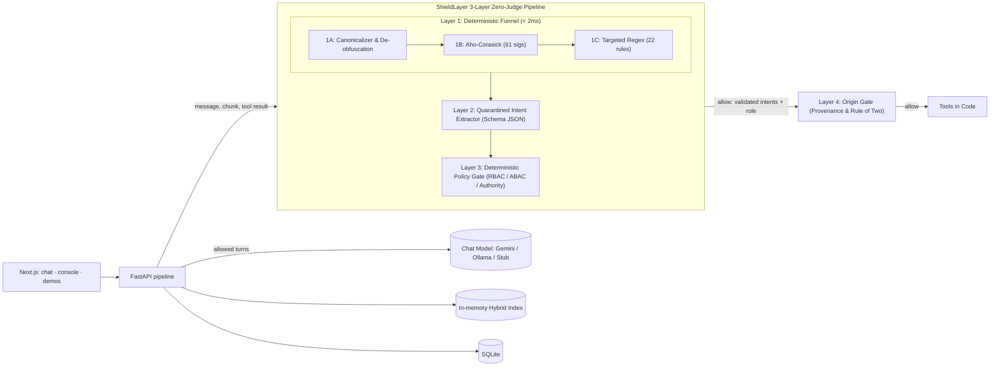

# 🛡️ ShieldLayer & KavachPay

**ShieldLayer is a 3-layer zero-judge security pipeline for LLMs and AI agents, demonstrated inside KavachPay (a fictional UPI support assistant).**

[](https://github.com/OWNER/kavachpay/actions/workflows/ci.yml)


**▶ Live demo:** `https://OWNER-kavachpay.hf.space` (replace after deploying, see [`docs/DEPLOY.md`](docs/DEPLOY.md))
· **No time?** Open **Recorded demos** on the sign-in page: all 8 missions replayed step by step, no sign-in, no tokens.

ShieldLayer implements a **3-Layer Zero-Judge Architecture** across every chat message, uploaded document chunk, and tool result:
1. **Layer 1 — 3-Stage Deterministic Security Funnel** (`1A Canonicalization` → `1B Aho-Corasick Multi-Pattern Scan` → `1C Targeted ReDoS-Safe Regex`).
2. **Layer 2 — Quarantined Intent Extractor & Neutralizer** (Zero tool access, strict JSON schema output, neutralizes phrasing into structured intents without allow/block power).
3. **Layer 3 — Deterministic Policy & Symbolic Gate** (100% pure deterministic code — zero AI, zero numeric scores — enforcing RBAC, ABAC, authority spoofing, and multi-intent smuggling checks against verified session identity).

Inside the KavachPay app, these three text-scanning layers are paired with an application-level **Layer 4 — Origin Gate** ([`app/provenance.py`](app/provenance.py)) that governs tool execution by **provenance** (`origin` and `arg_origins`) rather than text alone.

> Eliminating probabilistic LLM judges and opaque classifier score thresholds in favor of a deterministic, verifiable, schema-driven security gate. For open-source libraries, standards, and research citations behind each layer, see [`SOURCES.md`](SOURCES.md).

## Try it

| | |
|---|---|
| **Live chat** | Sign in as *Aarav Sharma (customer)* or *Security Admin*. In public demo mode (`PUBLIC_DEMO=1`), each visitor gets **4 free requests** (chat messages + uploads). |
| **Your own key** | Paste a free [Google AI Studio](https://aistudio.google.com/apikey) key for unlimited use. It stays in your browser tab and is sent only via the `X-Gemini-Key` header for that request (never stored or logged). |
| **Recorded demos** | `/demos`: replays of all 8 missions in the browser. Zero backend calls. |
| **Attack lab** | `/playground`: test any text across L1 Funnel, L2 Intent Extractor, and L3 Policy Gate as a chat message, doc chunk, or tool result. |

## Security Architecture

| Layer | What it is | Where | Speed |
|---|---|---|---|
| **1. Deterministic Funnel** | **3-Stage Sequential Funnel:**<br/>• **1A Canonicalization:** Unicode NFKC, invisible/Bidi stripping, homoglyphs, recursive decoding (URL/Hex/HTML/Base64, depth cap 3)<br/>• **1B Aho-Corasick:** $O(n)$ exact-match scan across **61** OWASP LLM / Agentic / MITRE ATLAS signatures<br/>• **1C Targeted Regex:** Lean, ReDoS-safe structural rules (**22** bounded patterns) | [`shield/layer1_funnel.py`](shield/layer1_funnel.py)<br/>[`shield/normalizer.py`](shield/normalizer.py)<br/>[`shield/aho_corasick_engine.py`](shield/aho_corasick_engine.py)<br/>[`shield/targeted_regex_engine.py`](shield/targeted_regex_engine.py)<br/>[`rules/`](rules/) | < 2 ms |
| **2. Quarantined Intent Extractor** | **Schema-Enforced Intent Extraction:**<br/>• Zero tool access, isolated from session role/DB, zero allow/block decision power<br/>• Extracts strict JSON (`intents[]`, `claimed_authority`, `urgency_or_override_tone`, `multi_intent_detected`)<br/>• Multi-provider adapter (`LAYER2_PROVIDER=auto`): `gemini` (default `gemini-2.5-flash` with `gemini-2.0-flash` 429 fallback), local `ollama` (`qwen2.5:3b`), or zero-key deterministic `heuristic` | [`shield/intent_extractor.py`](shield/intent_extractor.py)<br/>[`shield/layer2_providers.py`](shield/layer2_providers.py)<br/>[`config/intent_catalog.yaml`](config/intent_catalog.yaml) | ~100–200 ms (LLM) / < 1 ms (heuristic) |
| **3. Deterministic Policy Gate** | **100% Pure Deterministic Symbolic Gate (Zero AI, Zero Fuzzy Scores):**<br/>• **Extraction Check:** Blocks via `POL_EXTRACTION_FAILED` if L2 fails (when `LAYER2_ALLOW_HEURISTIC_FALLBACK=false`)<br/>• **Authority Spoofing (`ASI01` / `AML.T0054`):** Blocks via `POL_AUTHORITY_SPOOFING` if `claimed_authority` claims admin privileges on a non-admin session<br/>• **Intent Smuggling (`ASI01`):** Blocks via `POL_INTENT_SMUGGLING` when benign + unauthorized privileged intents are bundled<br/>• **RBAC & ABAC (`ASI02`):** Validates each intent's `allowed_roles` and target account ownership (`POL_RBAC_VIOLATION`, `POL_ABAC_VIOLATION`) | [`shield/policy_gate.py`](shield/policy_gate.py)<br/>[`config/intent_catalog.yaml`](config/intent_catalog.yaml) | < 1 ms |
| **4. Origin Gate** *(app layer)* | **Provenance & Capability Authorization (No text reading):**<br/>• Enforces `origin` (`user`, `admin`, `document`, `tool`, `model`) and `arg_origins` (`user`, `admin`, `database`, `document`, `tool`, `model`)<br/>• Blocks `untrusted-origin`, `role-mismatch`, `wrong-principal`, `tainted-argument`<br/>• Enforces `always_confirm` (`block_upi`) and **Rule of Two** confirmation after file upload | [`app/provenance.py`](app/provenance.py)<br/>[`app/pipeline.py`](app/pipeline.py) | < 1 ms |

### Layer 1 Deep Dive: The 3-Stage Deterministic Security Funnel

Layer 1 operates as a zero-GPU, sub-2 ms deterministic floor that de-cloaks obfuscated payloads and filters out known attack vectors and agentic sabotage commands before Layer 2 or any chat LLM sees the input:

```
[Untrusted Input / Chunk / Tool Result]
          │
          ▼
┌─────────────────────────────────────────────────────────────┐
│ Stage 1A: Canonicalization & De-obfuscation                 │
│ • Unicode NFKC normalization (math bold/italic, fullwidth)  │
│ • Strips invisible control & Bidi override characters       │
│ • Blocks on Trojan Source Bidi overrides (configurable)     │
│ • Homoglyph resolution (Cyrillic/Greek lookalikes -> ASCII) │
│ • Recursive decoding (URL, Hex, HTML, Base64) depth <= 3    │
└─────────────────────────────────────────────────────────────┘
          │
          ▼  (passes canonical text + unpacked payload spans)
┌─────────────────────────────────────────────────────────────┐
│ Stage 1B: Aho-Corasick Multi-Pattern Gate                   │
│ • O(n) exact-match pre-compiled automaton (61 signatures)   │
│ • Matches static LLM & agentic threat signatures            │
│ • Fails fast on high/critical severity matches              │
└─────────────────────────────────────────────────────────────┘
          │
          ▼  (surviving clean inputs only)
┌─────────────────────────────────────────────────────────────┐
│ Stage 1C: Targeted ReDoS-Safe Regex Engine                  │
│ • Lean set of 22 pre-compiled bounded regex rules           │
│ • Evaluates variable-gap, role-switching & agentic patterns │
└─────────────────────────────────────────────────────────────┘
          │
          ▼  (clean canonical text passes to Layer 2 Intent Extractor)
```

#### Why the Funnel Is Ordered This Way
1. **Cost & Latency Optimization:** Stage 1A and Stage 1B run in microseconds on CPU. Aho–Corasick executes in $O(n)$ time regardless of signature count, and Stage 1C regex evaluation only runs on spans that survive Stage 1B (in default `fail_fast` mode).
2. **Evasion Resistance (De-cloaking Before Scanning):** Attackers bypass raw string scanners using Unicode mathematical fonts (`𝐢𝐠𝐧𝐨𝐫𝐞`), Cyrillic/Greek lookalikes (`іgnоrе`), zero-width characters (`r\u200bm`), Trojan Source Bidi overrides (`\u202e`), or Base64/URL/Hex/HTML encoding. Running Stage 1A *first* normalizes and unpacks these spans before Stages 1B and 1C inspect them.
3. **Defense Against Catastrophic Backtracking (ReDoS):** Stage 1C is kept strictly lean (22 rules) with bounded quantifiers (e.g., `.{0,40}`) and zero nested quantifiers or unbounded `.*` spans.

#### Threat Coverage & Security Taxonomy
Layer 1 signatures/rules and Layer 3 policy codes map to open standards:
- **OWASP Top 10 for LLM Applications (2025):**
  - `LLM01` Prompt Injection (direct overrides, role-mimicking XML/Markdown tags, chat-template tokens `<|im_start|>`, `[inst]`, `<<sys>>`, Bidi/obfuscation)
  - `LLM05` Improper Output Handling & Data Exfiltration (Markdown image URL query exfiltration ``, output link/image sanitization)
  - `LLM06` Excessive Agency & SSRF (cloud metadata IP `169.254.169.254`, `metadata.google.internal`, loopback URLs, unauthorized tool origins)
  - `LLM07` System Prompt Leakage (canary fishing, initial prompt revelation requests)
  - `LLM10` Unbounded Consumption (inputs exceeding 4,000 characters)
- **OWASP Top 10 for Agentic Applications:**
  - `ASI01` Agent Goal Hijacking (injected `<tool_call>` / `function_call:` markup, authority spoofing, multi-intent smuggling)
  - `ASI02` Tool Misuse & Parameter Tampering (path traversal `../../`, shell chaining `; rm`, privilege escalation `update_role(role='admin')`, RBAC/ABAC violations)
  - `ASI06` Compliance & Procedure Fraud (phony "mandatory compliance procedure" directives)
- **MITRE ATLAS:**
  - `AML.T0051` LLM Prompt Injection & Direct/Indirect Manipulation
  - `AML.T0054` LLM Jailbreak Personas (DAN, developer mode, unrestricted framing)
  - `AML.T0057` LLM Data Exfiltration & System Abuse (`bash -i`, `/etc/passwd`, `/.env`, `/.ssh/id_rsa`, `aws_secret_access_key`)

---

### Rule & Policy Customization Guide

Rules and policy invariants are decoupled from code in YAML:

1. **Aho-Corasick Signatures ([`rules/aho_corasick_signatures.yaml`](rules/aho_corasick_signatures.yaml)):**
   ```yaml
   - id: ac_override_ignore_previous
     phrase: "ignore previous instructions"
     category: "instruction_override"
     severity: "high"   # critical | high | medium | low
     owasp_ref: "LLM01"
     mitre_ref: "AML.T0051.000"
     description: "Classic direct instruction override"
   ```
2. **Targeted Regex Rules ([`rules/regex_rules.yaml`](rules/regex_rules.yaml)):**
   ```yaml
   - id: agentic_privilege_escalation
     name: "Unauthorized Administrative Tool Call"
     category: "agentic_privilege_escalation"
     severity: "critical"
     owasp_ref: "ASI02"
     flags: "i"
     pattern: '\b(?:delete_user|grant_access|update_role|exec_sql|run_command)\s*\([^)]{0,200}(?:role|admin|sudo|root|privilege)[^)]{0,100}\)'
     description: "Tool invocation attempting to inject administrative roles"
     false_positive_notes: "Requires administrative function syntax with privileged args"
   ```
3. **Domain Intents & RBAC/ABAC Catalog ([`config/intent_catalog.yaml`](config/intent_catalog.yaml)):**
   Defines allowed roles (`user`, `admin`, `anonymous`), `requires_abac`, `requires_confirmation`, and fallback keywords for Layer 2 (`HeuristicProvider`) and Layer 3 (`PolicyGate`).

#### Adding & Testing New Rules
- Keep new regex rules in `rules/regex_rules.yaml` strictly bounded (e.g., `.{0,50}`) to prevent ReDoS.
- Add both positive (`should_match`) and benign negative (`should_not_match`) cases in [`shield/tests/test_stage1c_targeted_regex.py`](shield/tests/test_stage1c_targeted_regex.py).
- Run `pytest shield/tests` to verify Stages 1A–1C, Layer 2, Layer 3, and the full funnel.

---

### Layer 4 (Origin Gate) Rules

Why Layer 4 exists alongside L1–L3: adaptive attacks can evade text-based detectors ([Nasr, Carlini et al., 2025](https://arxiv.org/abs/2510.09023)), so tool execution needs an authorization check in [`app/provenance.py`](app/provenance.py) that **never reads message text**:

- **Only a signed-in principal can trigger an action (`untrusted-origin`).** Content (`document`, `tool`, `model`) can be read, never executed.
- **Role comes from the signed session (`role-mismatch`, `wrong-principal`).** A customer typing "I'm the admin" still has `origin=user`, and admin tools require `Origin.admin`.
- **Arguments must come from trusted origins (`tainted-argument`).** `raise_dispute` accepts `txn_id` only from `Origin.user` or `Origin.database`; an ID extracted from an uploaded PDF (`Origin.document`) is refused.
- **Rule of Two ([Meta, 2025](https://ai.meta.com/blog/practical-ai-agent-security/)) & Confirmation (`rule-of-two`, `needs-confirmation`):** Irreversible tools like `block_upi` always require confirmation, and once a session reads an uploaded file, every write action requires an explicit confirmation tap.

## The 8 Missions

| # | Mission | Proves |
|---|---|---|
| 1 | Real help, real data | Tools run in code, scoped to the signed-in customer |
| 2 | Direct prompt injection | Stopped by L1 before any model sees it |
| 3 | Never share a PIN | Secrets are masked before the model and the logs |
| 4 | Poisoned document | Hidden white-text injection quarantined before indexing |
| 5 | Pretend to be the admin | Polite admin requests pass L1, but L3/L4 refuse them on a customer session (`POL_AUTHORITY_SPOOFING` / `wrong-principal`) |
| 6 | Let a file give orders | An ID that only exists in a PDF can't drive `raise_dispute` (`tainted-argument`) |
| 7 | Poisoned tool output | Instructions inside a tool result are scanned (`source=tool`) and refused by L4 (`origin=tool`) |
| 8 | Right request, right person | The same sentence refused in #5 is allowed for the real admin; irreversible actions need a human tap |

## Also in the Box

- **Secure ingestion ([`app/rag/ingest.py`](app/rag/ingest.py)):** Every uploaded chunk (and decoded Base64 segment) is scanned before indexing (fail-closed). Flagged chunks go to quarantine, white/tiny (`<4pt`)/off-page PDF text is flagged, and documents with ≥30% flagged chunks (or score ≥ 0.98) are quarantined as a whole. Retrieval sees only public KB docs plus the visitor's own uploads.
- **Output checks ([`app/output_checks.py`](app/output_checks.py)):** Canary-leak refusal (`LLM07`), PII masking (`LLM02`), Markdown image & non-allowlisted link sanitization (`LLM05`), and `[cN]` citation validation (`LLM09`).
- **Live pipeline trace:** `/api/chat/stream` streams real-time NDJSON events (stages `1A`–`1C`, `layer2`, `layer3`, L4 gate verdicts, tools, and token progress). The reply is emitted only after `output_checks`.
- **Security console:** Overview (`/console`), live feed (`/live`), attack lab (`/playground`), quarantine (`/quarantine`), scorecard (`/scorecard`), and recorded demos (`/demos`).
- **Public demo guardrails ([`app/quota.py`](app/quota.py)):** Per-visitor request budget (`4`), per-network (`12`) and daily (`250`) caps, visitor-scoped uploads/quarantine/feed, and idle data reseed.

## Architecture



The chat turn pipeline in [`app/pipeline.py`](app/pipeline.py) runs sequentially:
`shield (L1 Funnel → L2 Intent Extractor → L3 Policy Gate)` → `redact` → `route` → `act (with L4 Origin Gate)` → `retrieve` → `rerank` → `build_context` → `origin_gate (L4 on private docs)` → `generate` → `output_checks`.

```
app/        FastAPI app, chat pipeline, L4 provenance gate, tools, RAG, quota
shield/     3-layer zero-judge pipeline: L1 funnel, L2 intent extractor, L3 policy gate
shared/     schemas, .env loader, BYOK context, pricing helpers
dashboard/  Next.js 15 chat, security console, attack lab, recorded demos
config/     intent catalog (RBAC & ABAC symbolic rules)
rules/      Aho-Corasick threat signatures + targeted ReDoS-safe regex rules
attacks/    attack library + scorecard runner
eval/       RAG quality & golden-set evals
scripts/    record_demos.py (re-records the mission replays)
deploy/     Hugging Face Space files
```

## Run it Locally

Full steps: **[`RUN_GUIDE.md`](RUN_GUIDE.md)**. Quick start (no API keys required):

```bash
make venv && make install                 # Python venv + deps
ollama pull qwen2.5:3b                    # local open-weight model for L2 & chat (optional)
make api                                  # API on :8080 (runs Shield in-process)
cd dashboard && pnpm install && pnpm dev  # http://localhost:3000
```

Without `GEMINI_API_KEY` or a running Ollama server, Layer 2 automatically falls back to the deterministic `HeuristicProvider` (when `LAYER2_ALLOW_HEURISTIC_FALLBACK=true`) and chat falls back to `StubChatModel`. Set `GEMINI_API_KEY` in `.env` (see [`.env.example`](.env.example)) and `CHAT_PROVIDER=gemini` to use Gemini, or run everything in one container:

```bash
docker compose up --build                 # -> http://localhost:7860
```

To run the Shield service standalone on `:8090`:

```bash
python -m uvicorn shield.app:app --port 8090
```

```bash
make test      # backend pytest suite (offline, never calls external APIs)
```

## Deploy Your Own

[`docs/DEPLOY.md`](docs/DEPLOY.md) covers single-container deployment and cost guardrails (`PUBLIC_DEMO=1` per-visitor, per-network, and daily request limits).

## Tech Stack

Python 3.12 · FastAPI · Pydantic · PyYAML · `pyahocorasick` · `confusable-homoglyphs` · SQLAlchemy/SQLite · FastEmbed · PyMuPDF · Ollama / Gemini API · Next.js 15 · React 19 · TypeScript · Tailwind CSS · Docker.

## Open-Source Sources & Attributions

ShieldLayer is built on open-source software and open security standards (OWASP LLM Top 10, OWASP Agentic Top 10, MITRE ATLAS, Unicode UTS #39 / Trojan Source, Dual-LLM / CaMeL quarantined extraction, RBAC/ABAC, and Meta's Rule of Two). See **[`SOURCES.md`](SOURCES.md)** for the full layer-by-layer breakdown, paper citations, and dependency licenses.

## Current Limitations (Stated Honestly)

- **Layer 2 fallback mode:** By default, `LAYER2_ALLOW_HEURISTIC_FALLBACK=true` falls back to `HeuristicProvider` if Gemini/Ollama is unreachable or fails. Set `LAYER2_ALLOW_HEURISTIC_FALLBACK=false` in production for strict fail-closed blocking (`POL_EXTRACTION_FAILED`).
- **In-memory vector index:** Rebuilt from the knowledge base on every server start.
- **Rule-based tool planner:** `node_act` in [`app/pipeline.py`](app/pipeline.py) uses deterministic patterns to plan tool calls behind the Layer 4 gate.
- **Multi-turn & demo auth:** Multi-turn attacks split across messages remain a harder case; authentication uses demo-grade signed cookies and two fixed profiles with fictional data.
