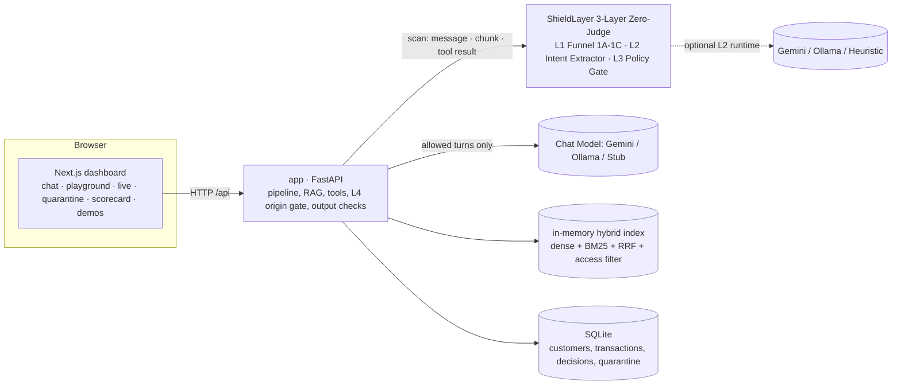

# Architecture

One app process plus the Shield (in-process, or as its own service on :8090).
There is no proxy between the app and the model: the app runs the 3-layer
zero-judge pipeline on every chat message, document chunk, and tool result
**before** the chat model sees it, enforces provenance authorization via the
Layer 4 Origin Gate before any tool runs, and runs output checks **after**
generation. Uploaded chunks reach the vector store only if they pass the scan.

## Two flows

**Chat (Flow A):** shield (`L1` 1A–1C deterministic funnel → `L2` quarantined
intent extractor → `L3` deterministic RBAC/ABAC policy gate) → redact
PIN/OTP/card → route intent → act (tools in code behind `L4` Origin Gate,
confirmations for irreversible actions and tainted sessions) → retrieve
(hybrid + RRF, access-filtered) → rerank → build_context → origin_gate (`L4`
on private uploads) → generate → output_checks (canary, PII, markdown,
citations). A blocked message never reaches the model.

**Upload (Flow B):** 202 / NDJSON stream → parse (`pymupdf` / `docling`) →
hidden-text flag → normalise → heading-aware split → **scan every chunk
(fail-closed)** → enrich clean chunks only (optional) → index clean / quarantine
flagged. No LLM reads a chunk before it passes the scan.
